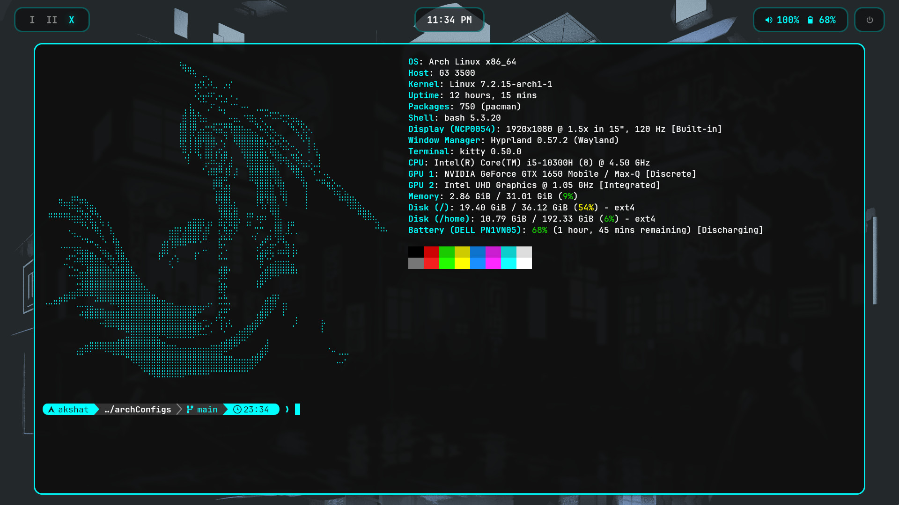
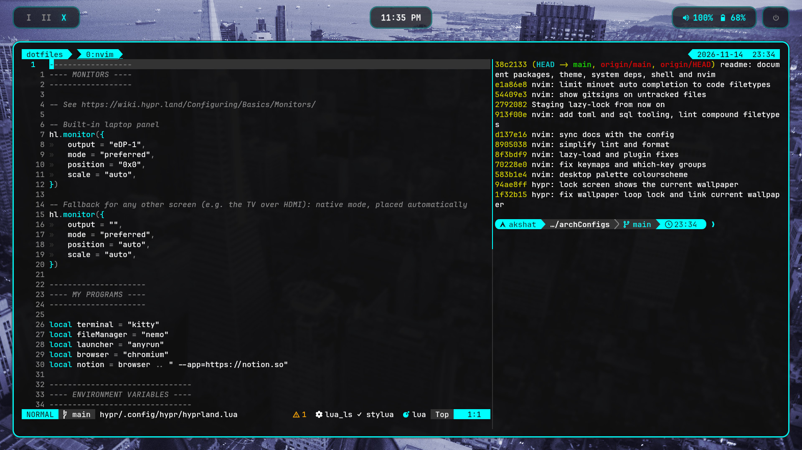
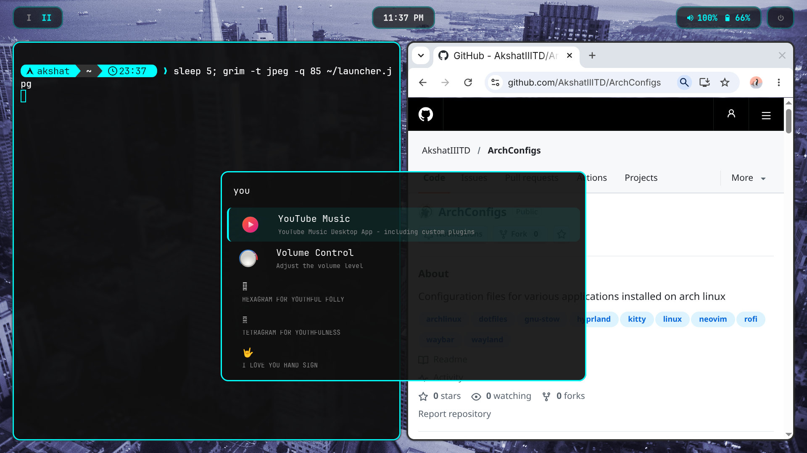

# ArchConfigs

Dotfiles for an Arch Linux + Hyprland (Wayland) desktop, managed with [GNU Stow](https://www.gnu.org/software/stow/).
Each top-level folder is a Stow package that mirrors `$HOME`: `hypr/.config/hypr/hyprland.lua`
is symlinked to `~/.config/hypr/hyprland.lua`, so editing a file here changes the live desktop.







Wallpapers rotate from `~/Pictures/Wallpapers` and are not part of this repo. The ones in the
screenshots come from [D3Ext/aesthetic-wallpapers](https://github.com/D3Ext/aesthetic-wallpapers) (MIT licence).

## Tested on

- Arch Linux (rolling) with Hyprland 0.57 and its Lua config
- Dell G3 3500 laptop: 15.6" 1920×1080 120 Hz panel at 1.5× scale
- Hybrid graphics: Intel UHD (integrated) + NVIDIA GTX 1650 (an external screen over HDMI needs the NVIDIA driver)
- External 2560×1440 screen over HDMI, placed automatically by the fallback monitor rule

Monitor names, scale and the laptop media/brightness keys in `hyprland.lua` are specific to this machine;
adjust the MONITORS group for yours.

## Install

Clone the repository, then in its base folder do a dry run first and check the output:

```
stow -n -v -t ~ anyrun fastfetch hypr kitty mako swayosd waybar misc nvim
```

If it reports no conflicts, run the same command without `-n`. Move away any existing file
it complains about instead of using `--adopt`, which overwrites the repo with your local copy.

## Packages

| Package | Contents |
|---|---|
| `hypr` | Hyprland (`hyprland.lua` is the active config, `hyprland.conf` is the inactive fallback), hypridle, hyprlock, hyprpaper, wallpaper script |
| `waybar` | Status bar |
| `mako` | Notifications |
| `swayosd` | Volume and brightness on-screen display |
| `anyrun` | Launcher |
| `kitty` | Terminal |
| `fastfetch` | System info |
| `nvim` | Neovim (see below) |
| `misc` | `.bashrc`, `.bash_profile`, starship prompt, tmux, mise, pavucontrol, YouTube Music flags |

## Theme

Every themed app uses the same palette and font, so reuse these values instead of adding new ones.

| Role | Value |
|---|---|
| Background | `#0f0f0f` (pills and OSD use alpha 0.7) |
| Foreground | `#ffffff` |
| Accent | `#00ffff` (pill and OSD borders use `rgba(0,255,255,0.3)`) |
| Muted | `#888888` |
| Surface | `#333333` (inactive borders, prompt middle block, tmux inactive pane) |
| Warning | `#ffaa00` |
| Critical | `#ff3333` |

Font: JetBrainsMono Nerd Font. Neovim uses it through `colors/desktop.lua` and a matching lualine theme.

## System packages

Install these with pacman or your AUR helper; some are only in the AUR.

- **Desktop:** `hyprland`, `hypridle`, `hyprlock`, `hyprpaper`, `hyprshutdown`, `hyprpicker`, `waybar`, `mako`, `swayosd`, `anyrun`
- **Tools used by keybinds and scripts:** `kitty`, `nemo`, `chromium`, `grim`, `slurp`, `wl-clipboard`, `playerctl`, `brightnessctl`, `pavucontrol`
- **Shell:** `bash`, `starship`, `mise`, `tmux`, `fastfetch`
- **Font:** a JetBrainsMono Nerd Font (for example `ttf-jetbrains-mono-nerd`)

`hyprshutdown` is used for a graceful exit by the exit bind and the waybar power buttons.
`brightnessctl` is used for the idle dim step in hypridle.

## Hyprland

The active config is `hypr/.config/hypr/hyprland.lua`. Before reloading after a change,
check it for errors (`hyprctl configerrors` after a reload, or `Hyprland --verify-config`).

### Wallpapers

Wallpaper images are not stored in this repo. Put them in `~/Pictures/Wallpapers`
(png, jpg, jpeg or webp). hyprpaper shows one at login, `scripts/wallpaper.sh`
switches to a random one every 30 minutes, and SUPER + W switches immediately.
The lock screen shows the current wallpaper.

## Shell

`misc/.bash_profile` loads `~/.bashrc`, which starts starship (plain prompt if it is not installed)
and activates mise. mise pins Node 22 in `misc/.config/mise/config.toml`.

## Neovim

Neovim 0.11 or newer, with lazy.nvim, native `vim.lsp.config`, blink.cmp, conform and nvim-lint.
Plugin versions are pinned in `nvim/.config/nvim/lazy-lock.json`; run `:Lazy restore` to return to them.
Docs for keymaps, LSP and telescope are in `nvim/.config/nvim/docs/`.

Needed outside Neovim:

- `tree-sitter-cli` and `base-devel` (gcc, make), for treesitter parsers and telescope-fzf-native
- `ripgrep` and `fd` for telescope; `bat` is optional
- `nodejs` and `npm` (mise provides Node), `python` with `pip` or `uv`, `go`, `rustup` with `rustfmt`, and a JDK 21, because Mason builds or runs many tools with these
- `wl-clipboard` for the system clipboard

Mason installs the language servers, formatters and linters on first start (taplo, sqlfluff, prettier,
ruff, hadolint and others). SQL formatting and linting only run in projects that have a `.sqlfluff` file with a dialect.

jdtls (Java) is not installed by Mason. jdtls 1.63 and newer need Java 25, and Mason cannot pin an older
version, so it is pinned to 1.61.0 (works on Java 21) and installed by a script instead. Run it once per machine:

```
bash ~/.config/nvim/scripts/install-jdtls.sh
```

It downloads the Eclipse milestone, verifies its SHA-256 and installs into `~/.local/share/nvim/jdtls/1.61.0`.
To move to a newer jdtls after upgrading Java, change the version, build and checksum in the script and `JDTLS_VERSION` in `ftplugin/java.lua`.

Optional AI completion (CodeCompanion and minuet) is off unless `lua/config/ai_local.lua` exists.
That file is gitignored because it holds your LLM host and settings, so create it on each machine.
Auto completion only triggers for an allowlist of code filetypes; override it with `complete_filetypes` in that file.

## Keybinds

SUPER is the main modifier. Keep this table in sync with `hyprland.lua`.

### Apps
| Keys | Action |
|---|---|
| SUPER + T | Terminal (kitty) |
| SUPER + F | File manager (nemo) |
| SUPER + B | Browser (chromium) |
| SUPER + N | Notion (chromium app window) |
| SUPER + SPACE | Launcher (anyrun) |
| Print | Screenshot a region to the clipboard |
| SUPER + SHIFT + C | Colour picker (hyprpicker) |
| SUPER + W | Next random wallpaper |

### Windows
| Keys | Action |
|---|---|
| SUPER + Q | Close window |
| SUPER + M | Toggle fullscreen |
| SUPER + V | Toggle floating |
| SUPER + P | Pseudo-tile |
| SUPER + J | Toggle split direction (dwindle) |
| SUPER + Arrow keys | Move focus |
| SUPER + Left drag | Move window |
| SUPER + Right drag | Resize window |

### Workspaces
| Keys | Action |
|---|---|
| SUPER + 1–9, 0 | Go to workspace 1–10 |
| SUPER + SHIFT + 1–9, 0 | Move window to workspace 1–10 |
| SUPER + S | Show/hide the scratchpad |
| SUPER + SHIFT + S | Move window to the scratchpad |
| SUPER + Scroll | Next/previous existing workspace |
| 3-finger swipe (horizontal) | Switch workspace |

### Session
| Keys | Action |
|---|---|
| SUPER + L | Lock screen |
| SUPER + SHIFT + CTRL + Q | Exit Hyprland |

### Notifications
| Keys | Action |
|---|---|
| SUPER + ESCAPE | Dismiss the top notification |
| SUPER + SHIFT + ESCAPE | Toggle do-not-disturb (critical notifications still show) |

### Media keys (also work while locked)
| Keys | Action |
|---|---|
| Volume Up / Down | Volume ±, capped at 100%; hold to repeat |
| Mute / Mic Mute | Toggle output / input mute |
| Brightness Up / Down | Brightness ±; hold to repeat |
| Play / Pause | Play/pause |
| Next / Prev | Next / previous track |

## License

[MIT](LICENSE). The wallpapers shown in the screenshots are from
[D3Ext/aesthetic-wallpapers](https://github.com/D3Ext/aesthetic-wallpapers) and are not part of this repo.
